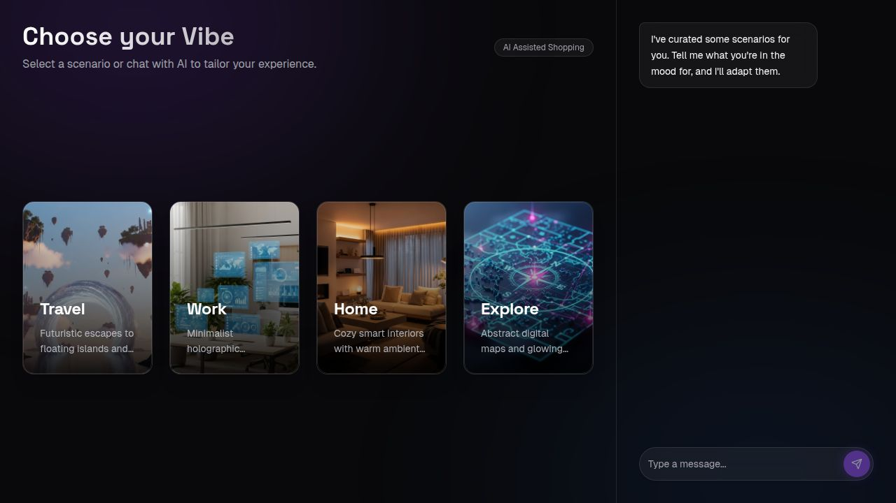

# Flow UX Exploration — Product Documentation

This repository is a UX exploration for **STYLIST_AI**: a context-aware AI shopping + wardrobe management experience with a “clinical sci‑fi” interface and an always-available AI assistant.

These docs are written as a **product spec for the mock**: what the product *is*, how it *flows*, how it *looks*, and the mechanisms it implies. Implementation details are intentionally minimized.

**Last reviewed:** 2026-02-18  
**Source of truth:** UX represented in `client/src` (screens + overlays) and the included design reference images.

## How To Use This Spec

1. Start with **Vision** and **Core Concepts** to align on intent and vocabulary.
2. Read **User Journeys** to understand the end-to-end experience.
3. Use **Screen Specs** + **Overlay Specs** as build-ready requirements.
4. Use **Patterns** + **Design Language** as the UI system baseline.

## Spec Map

### Product
- [Vision](vision.md)
- [Feature Catalog](feature-catalog.md)
- [Core Concepts](core-concepts.md)
- [Information Architecture](information-architecture.md)
- [User Journeys](user-journeys.md)
- [Data Model (Conceptual)](data-model.md)
- [States & Statuses](states-and-statuses.md)
- [Minimum Loveable Product (MLP) Scope](mlp-scope.md)
- [Open Questions & Gaps](open-questions.md)
- [Glossary](glossary.md)

### Design & UX
- [Design Language](design-language.md)
- [Visual Tokens](visual-tokens.md)
- [Copy Style Guide](copy-style-guide.md)
- [UI Patterns](patterns.md)

### Screen Specs
- [Scenario Picker](screen-specs/scenario-picker.md)
- [Context Upload / Context Analysis](screen-specs/context-upload.md)
- [Inventory Selection (Asset Digitization)](screen-specs/inventory-selection.md)
- [My Inventory](screen-specs/my-inventory.md)
- [Global Search (Global Item Database)](screen-specs/global-search.md)
- [Avatar Selection (Target Acquisition)](screen-specs/avatar-selection.md)
- [Style Discovery (Style Matrix Calibration)](screen-specs/style-discovery.md)
- [Product Feed (Curation Queue)](screen-specs/product-feed.md)

### Overlay Specs (Cross-Cutting)
- [Persistent AI Assistant (Chat Bar)](overlays/persistent-chat.md)
- [Reasoning Overlay (Deduction Chain + Evidence Locker)](overlays/reasoning-overlay.md)
- [Shortlist & Inventory Drawer](overlays/shortlist-overlay.md)
- [Comparison Matrix](overlays/comparison-matrix.md)
- [Inventory Item Detail](overlays/inventory-item-detail.md)
- [Capsule Detail](overlays/capsule-detail.md)
- [Features Overview (“System Capabilities”)](overlays/features-overview.md)
- [Expanded Image Modal](overlays/expanded-image-modal.md)

### Templates (For Extending This Spec)
- [Screen Spec Template](_templates/screen-spec-template.md)
- [Overlay Spec Template](_templates/overlay-spec-template.md)
