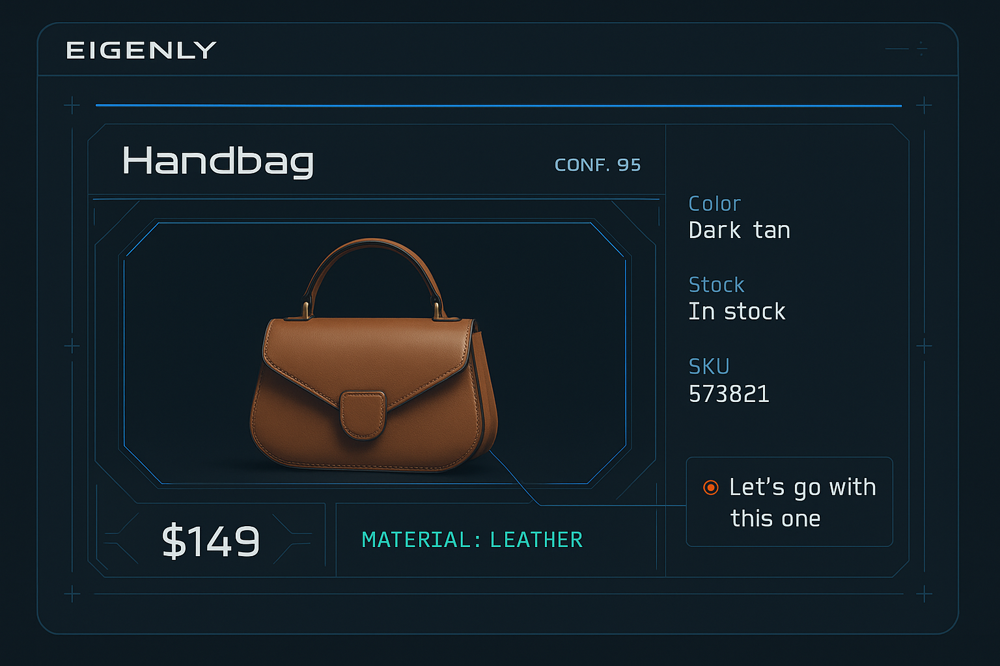
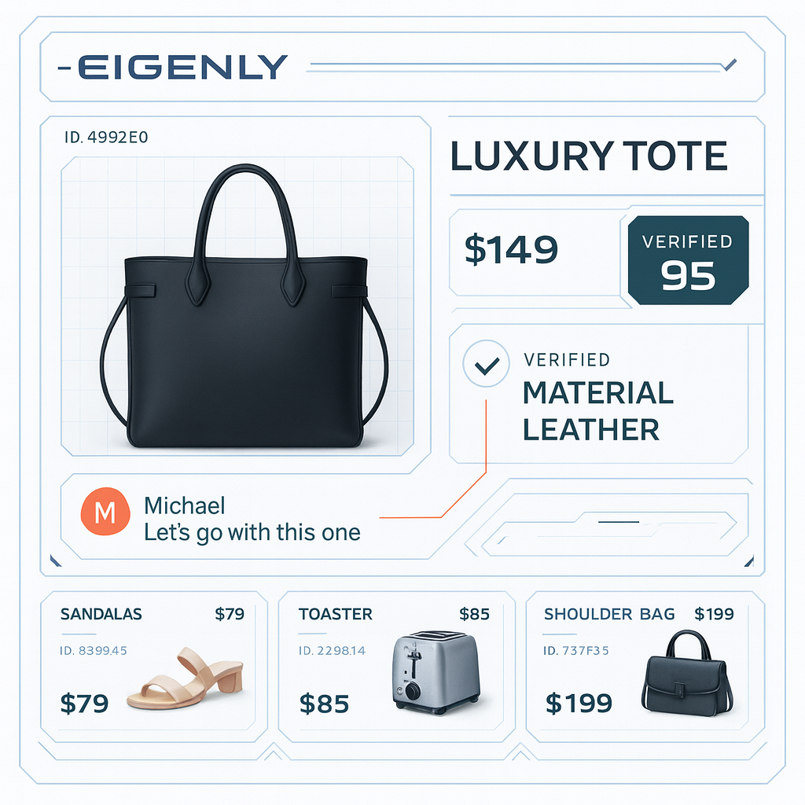

# Design Language

The mock is intentionally opinionated: it treats shopping as a *technical* system you can inspect and steer, not a feed you mindlessly scroll.

## Visual Reference

The repo includes design reference images used as style/skin inspiration:

- Dark variant reference:
  - `attached_assets/EE2542F5-CC5E-45DD-8032-6D5FBDE37682_1769481479224.png`
- Light variant reference:
  - `attached_assets/55990E3B-27CA-404A-AA90-DDC262F4074C_1769481466371.png`

## Aesthetic Pillars

1. **Clinical sci‑fi**: clean lines, subtle grid overlays, system labels, instrument panels.
2. **Sharp geometry**: chamfered corners and crisp borders (little to no soft rounding).
3. **High signal density**: metadata is present, but visually secondary (monospace, smaller, muted).
4. **Motion as meaning**: animations communicate state transitions (selection, overlays, queue advance).

## Typography System

The mock uses a three-font hierarchy:

- **Display / headings**: Rajdhani (uppercase, tracking; used for “system module” headings).
- **Body**: Inter (readable paragraphs and descriptions).
- **Mono / metadata**: JetBrains Mono (IDs, statuses, step labels, microcopy).

### Copy Style

- Headings and key actions are **uppercase**, often with **underscores** (e.g., `CONFIRM_AND_CONTINUE`).
- System module titles often have a leading hyphen (e.g., `-CONTEXT_ANALYSIS`).
- Labels and system statuses look like terminal output (e.g., `PHASE: 02 - DATA_INGESTION`).

## Color + Materials

The UI relies on:

- A light, slightly blue background and a dark navy/charcoal foreground.
- A strong, calm **primary** blue for system emphasis.
- A high-chroma **accent** orange for “signal” moments (corners, indicators, highlights).
- White cards with borders; shadows are subtle and used sparingly.

## Layout Grammar

Common structure across screens:

- **Max-width container** (centered) for content-heavy flows.
- **Sticky top headers** for “module title + quick controls.”
- **Two-column layouts** when pairing “analysis / preview” with “inputs / gallery.”
- **Floating action bars** near the bottom for “selected count + primary CTA.”
- **Persistent chat bar** pinned to the bottom, acting as an assistant console.

## Iconography

Icons are used as quick category cues and are typically:

- Monochrome with contextual tint (blue/amber/cyan/purple).
- Placed in small “badge” containers with borders/backgrounds.

## Interaction Highlights

- Selection uses **rings**, **check badges**, and **tinted backgrounds**.
- Hover reveals controls (carousel arrows, overlay actions).
- Overlays are “instrument panels” with strong separation and clear hierarchy.

