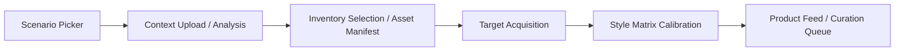

# User Journeys

This document describes end-to-end flows as experienced in the mock, plus the intended side paths revealed via overlays.

## Journey 1 — Primary Onboarding + Feed Generation

**Goal:** produce a personalized product feed grounded in context + wardrobe.

### Steps

1. **Pick a scenario**  
   - User selects a scenario card.  
   - In the mock, selecting `Work` advances.

2. **Upload context & review insights**  
   - User uploads images/video and/or adds links.  
   - System displays 3 insight cards with confidence.  
   - User can open reasoning to inspect evidence.

3. **Build the asset manifest**  
   - User selects owned items from inventory and/or global search.  
   - User can direct upload item images.  
   - Right-side “Asset Manifest” acts as a visible constraint list.

4. **Select targets**  
   - User chooses clothing categories (by body zone).

5. **Calibrate style matrix**  
   - User “likes” items from a style spectrum.  
   - A floating bar appears once any items are selected.

6. **Enter product feed**  
   - User sees a curation queue and a focused product detail view.  
   - User provides continuous feedback (like/no/shortlist/own).

### Flow Diagram (Mock)

## Journey 2 — “Why This?” (Reasoning Deep Dive)

**Goal:** build trust and let users correct the system.

1. User clicks an insight card (“Detected_Environment”, etc.) or “WHY THIS MATCH?” in the feed.
2. Reasoning overlay opens.
3. User inspects:
   - sources around the claim,
   - a deduction chain timeline,
   - evidence artifacts per step.
4. User returns and can adjust inputs (via uploads or chat).

## Journey 3 — Shortlist Management (Decision Workspace)

**Goal:** move items from interest → decision → acquisition feedback.

1. User opens **Active Shortlist** (drawer).
2. User selects up to 3 items for comparison.
3. User runs comparison matrix.
4. User chooses to buy (“BUY_NOW”).
5. Post-purchase modal asks for outcome:
   - purchased,
   - still deciding,
   - problem/failure.

## Journey 4 — Inventory Management (Owned Asset Workspace)

**Goal:** treat owned items as durable assets with history and actions.

1. User opens **My Inventory** (drawer, inventory tab) or visits inventory screens.
2. User opens an item detail.
3. The system may prompt:
   - “Long time no see — do you still own it?”
4. User can:
   - add media,
   - update condition,
   - log wear/verification events,
   - read capsule recommendations,
   - run lifecycle actions (return/repair/sell/etc.).

## Journey 5 — Capsule Creation (Outfit Synthesis)

**Goal:** generate outfits from owned items.

Entry points:
- From an inventory item detail (“Smart Capsules” / generate new).
- From inventory drawer selection mode (“SELECT ITEMS” → “CREATE CAPSULE”).

Result:
- A capsule detail view with collage, reasoning, and action CTAs (plan outfit, save capsule).

